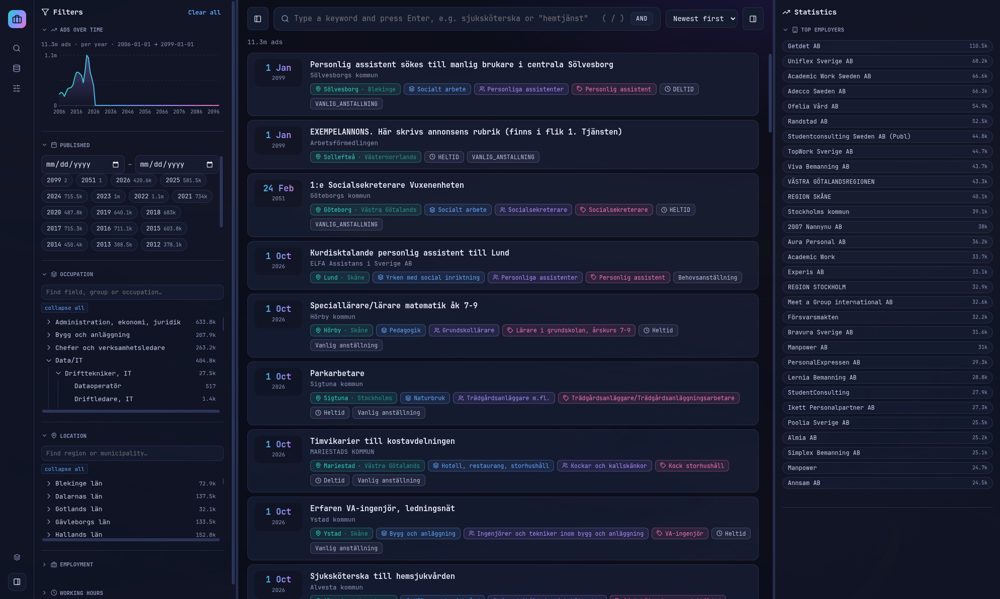

# AMS Viewer

Desktop app for browsing historical Swedish job ads (Arbetsförmedlingen / JobTech open data). Import one or more JSONL files, then search and filter by keyword, occupation, location, date and more, and read ads in a job-ad style view.



## FAIR WARNING!
This is an attempt / experiment in fully vibe-coding an application. Extremely little (if any) code change has been made "by a human".

## Getting the data
Arbetsförmedlingen publishes their historical data at https://data.arbetsformedlingen.se.

The exact location of the data files, at the time of writing, is: https://data.arbetsformedlingen.se/annonser/historiska/index.html

## Using the app

1. Start the app (see below).
2. Open **Datasets** and click **Choose files…** (or drag and drop) to import one or more `.jsonl`, `.ndjson` or `.json` files. A quarter-sized file (~130k ads, ~770 MB) imports in roughly half a minute.
3. Go to **Search ads**. Choose filters in the left panel; search headlines, employers and descriptions with keywords or quoted phrases. Choose AND or OR for multiple keyword entries. Click an ad to open it.
4. Use **Swap dataset** to create or switch collections. Edit a dataset's name and description in place; delete datasets from the chooser. Switching clears current filters. Dataset deletion removes its local database, not original source files.
5. Use **Reprocess dataset** on the Datasets page when stored search indexes or summaries need rebuilding. It works without source files, asks for confirmation, and may take a long time.

| Action | How |
|---|---|
| Show keybinds | Press `?` |
| Jump from an ad to a filter | Click a tag or breadcrumb item |
| Filter by employer | Click a Top employers entry; remove its "Employer: …" chip to clear it |
| Clear current filters | **Clear all** in the filter panel |
| Remove an imported source | Datasets → source row → **Remove**; original file stays untouched |
| Rebuild indexes and summaries | Datasets → **Reprocess dataset**; confirm the long-running operation |
| Change theme | Settings → Appearance → current theme name; select a preview panel |

Themes include **ams-dark** and **ams-light**. The chooser can import a JSON theme, download a copy, or remove a custom theme after confirmation; built-ins are protected. Each theme defines colors and default/monospace local font stacks. The separate Monospace font switch chooses the stack, and both preferences persist independently of datasets. Theme authoring and all supported options: [theming reference](docs/theming.md).

Filters are remembered while browsing a dataset and reset when switching datasets. Data is stored locally in Electron's `userData` folder: `~/.config/AMS Viewer/` on Linux, `~/Library/Application Support/AMS Viewer/` on macOS, or `%APPDATA%\AMS Viewer\` on Windows. The catalog is `datasets.json`; each dataset has its own database under `datasets/`. Source files are not needed after import. Back up this folder before upgrading from versions that used `ads.db`.

Suspect publication dates do not cause automatic exclusion. Manual ad exclusion is not available yet.

## Running as a developer

Requirements: Node.js 22.5+ and npm (Electron 44 bundles Node 24 with `node:sqlite`; no native modules to build).

```bash
npm install
npm start               # add --no-sandbox if the Electron sandbox helper is missing
node --check src/renderer/app.js
```

### Project layout

```
src/main/       Electron main process: main.js, preload.js, db.js, import-worker.js, read-worker.js, splash-preload.js
src/renderer/   UI: index.html, styles.css, app.js (plain JS, no build step)
src/shared/     Shared theme validation/application and regression tests
src/themes/     Built-in ams-dark and ams-light JSON themes
requirements/   Requirements with IDs (what the app shall do)
docs/           System description, technologies, design decisions, constraints, data model
AGENTS.md       Rules for working in the project (also used by the Copilot agent)
```

### Working with the project

- Every change traces to a requirement ID in [requirements/](requirements/README.md). Add one if none fits.
- Record major decisions in [docs/design-decisions.md](docs/design-decisions.md) with a `**Requirements**:` line.
- Keep docs and requirement statuses current in the same change. Details: [AGENTS.md](AGENTS.md).
- Source data files and the database must not be committed.

### Inspecting the database

```bash
node --no-warnings -e "
const d=require('./src/main/db');
const db=d.open(process.env.HOME+'/.config/AMS Viewer/datasets/default.db');
console.log(d.info(db), d.search(db,{terms:['sjuksköterska']},0,5,true));"
```

## Building for distribution

Packaging uses [electron-builder](https://www.electron.build/), configured in the `build` section of `package.json`. Only `src/**` and `package.json` are bundled, so data files in the project folder are never included. Output goes to `dist/`.

```bash
npm install
npm run pack    # unpacked app for quick testing: dist/linux-unpacked/ (or win-/mac- equivalent)
npm run dist    # installers for the current platform
```

| Platform | Target | Build on |
|---|---|---|
| Linux | AppImage | Linux |
| Windows | NSIS installer | Windows (or Linux with Wine) |
| macOS | dmg | macOS |

Release checklist:

1. Update `version` in `package.json`.
2. Confirm related requirements and docs are current (see [AGENTS.md](AGENTS.md)).
3. Run `npm run pack` and launch the result; open Datasets, import a small file, search, open an ad.
4. Run `npm run dist` on each target platform and distribute the files from `dist/`.

Current state and limits: only the unpacked Linux build has been tried (it starts); AppImage, Windows and macOS targets are untested, and there is no code signing, custom icon or auto-update (see [docs/constraints.md](docs/constraints.md), requirement NFR-009).

## Documentation

- [docs/README.md](docs/README.md): system description, technologies, design decisions, constraints, data model
- [requirements/README.md](requirements/README.md): requirement index and format
