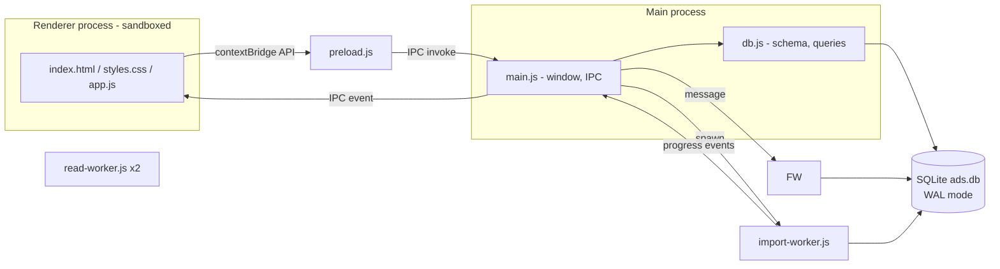

# System description

## Purpose

Browse, filter and read historical job ads offline. Source data is published as one JSONL file per period (e.g. `2026-Q3.jsonl`, ~770 MB, ~130k ads). The app imports such files into a local database and offers a fast, dark-themed UI on top.

## Functional overview

- **Search view**: filter panel (left) + keyword box, sort and result list (right).
  - Keyword search (headline, employer, description), with `"phrases"` and prefix matching.
  - Hierarchical filters: occupation field → group → occupation; region → municipality.
  - Date range and one-click year chips; employment type; working hours.
  - Ads-over-time chart stays above publication-date filters in the left column. All six filter/chart widgets collapse independently using their title buttons; collapsed filters show active-selection counts (D27). Sections scroll without shrinking into overlapping titles or inputs.
  - Sort: newest, oldest, relevance (keyword only).
  - Results update live while typing/selecting; the list loads incrementally while scrolling.
  - Active filters shown as removable chips; "Clear all".
- **Ad view**: job-ad style presentation (hero header, formatted description, requirements, how to apply, at-a-glance facts, employer info), with a clickable breadcrumb and clickable tags that apply filters.
- **Data sources view**: import (file picker or drag & drop, multiple files), progress, per-source removal, totals.
- **Settings view**: separate sidebar destination with an Appearance section; monospace typography for all main-window text defaults on and can be toggled immediately. Additional settings can be added here (D26).
- **Navigation**: sidebar menu; Backspace, mouse back/forward buttons and Alt+←/→ move through view history; `/` focuses search.
- **Persistence of state**: filters are kept in `sessionStorage` (only while the app is open); tree expansion, layout (including per-widget collapse) and application settings are saved in `localStorage`; the list view is kept alive (hidden) while another view is open, preserving scroll position.

## Architecture

### Components

| File | Role |
|---|---|
| `src/main/main.js` | Creates the window, registers IPC handlers, spawns workers, validates input (file extensions, URL scheme). |
| `src/main/preload.js` | Exposes a minimal `window.api` via `contextBridge`. |
| `src/main/db.js` | Schema, row mapping, filter → SQL builder, search, facets, ad lookup, source removal. Shared by main and workers. |
| `src/main/import-worker.js` | Streams a file, maps records, inserts into `ads` and `ads_fts` in batched transactions, reports progress. |
| `src/main/read-worker.js` | All database reads, on their own connections: five instances (lanes): `lists` (rows, single ad, info), `counts`, `timelines`, `facets` and `build` (one-time summary build, source removal), so a slow request never delays another. The main process only queues requests (a newer request of the same kind supersedes a queued older one). |
| `src/main/splash-preload.js`, `src/renderer/splash.*` | Splash window with progress bar shown while the database summary and first results load (UI-014). |
| `src/renderer/app.js` | All UI logic: state, history, list, filter trees, ad rendering, data view. No framework. |

## Data flow

1. **Import**: renderer asks main to import → main starts `import-worker` → worker streams records → rows + FTS entries inserted (duplicates by ad id skipped) → progress events relayed to the UI → on completion the list and facets reload.
2. **Search**: filter change → `setF` saves state → `ads:search` (page of 60 + total on first page) and `ads:facets` (counts for all filter panels) run in parallel. Stale responses are discarded via sequence counters.
3. **Open ad**: row click → history `pushState` → `ads:get` returns the stored (null-pruned) JSON → rendered as a job ad.

## Facet semantics

Each filter group's counts are computed with all *other* filters applied but its own ignored. This lets the user see alternatives within a group (e.g. other occupation fields) while still reflecting keyword, date and location choices.

Options never disappear: every option present in the data is returned with its count (0 when no ad matches) and shown grayed out but selectable (SRC-015). The unfiltered option lists and the chart/total shortcuts come from the summary tables (D23), which the importer keeps current.
