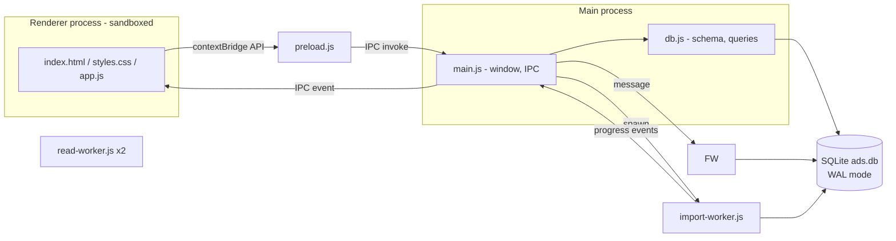

# System description

## Purpose

Browse, filter and read historical job ads offline. Source data is published as one JSONL file per period (e.g. `2026-Q3.jsonl`, ~770 MB, ~130k ads). The app imports such files into a local database and offers a fast, dark-themed UI on top.

## Functional overview

- **Search view**: filter panel (left), keyword box/sort/result list (center), and statistics column (right).
  - Keyword search (headline, employer, description), with `"phrases"` and prefix matching.
  - Hierarchical filters: occupation field → group → occupation; region → municipality.
  - Date range and one-click year chips; employment type; working hours.
  - Ads-over-time chart stays above publication-date filters in the left column. All six filter/chart widgets collapse independently using their title buttons; collapsed filters show active-selection counts (D27). Sections scroll without shrinking into overlapping titles or inputs.
  - Every filter widget resizes vertically through its bottom divider, with independent remembered body heights and keyboard-accessible separators. Resizing moves subsequent widgets down; overflowing content scrolls within the body. Collapse and Clear all preserve dimensions (D34).
  - The statistics column uses the same title collapse and vertical-resize helpers for Geography and Top employers; these are unavailable shells until T5/T9 supply data (D35). Its left divider resizes width from an initial/minimum 280 px, with pointer and keyboard controls and an independently saved preference (D36). Filter and statistics columns have independent remembered icon toggles. Statistics auto-hides below 1200 px; when space cannot accommodate both columns and 420 px of results, the most recently opened/resized column wins without overwriting the other's saved preference. Both preferred sidebar widths are temporarily clamped on smaller windows and restored when space returns.
  - Sort: newest, oldest, relevance (keyword only).
  - Results update live while typing/selecting; the list loads incrementally while scrolling.
  - Active filters shown as removable chips; "Clear all".
- **Ad view**: job-ad style presentation (hero header, formatted description, requirements, how to apply, at-a-glance facts, employer info), with a clickable breadcrumb and clickable tags that apply filters.
- **Data sources view**: import (file picker or drag & drop, multiple files), progress, per-source removal, totals.
- **Settings view**: separate sidebar destination with an Appearance section; monospace typography for all main-window text defaults on and can be toggled immediately. Additional settings can be added here (D26).
- **Navigation**: sidebar menu; Backspace, mouse back/forward buttons and Alt+Left/Right move through view history; `/` searches the current context (list search or in-ad find); `?` opens view-specific shortcut help (D31).
- **Persistence of state**: filters are kept in `sessionStorage` (only while the app is open); tree expansion, layout (including per-widget collapse and heights) and application settings are saved in `localStorage`; the list view is kept alive (hidden) while another view is open, preserving scroll position.

## Architecture

### Components

| File | Role |
|---|---|
| `src/main/main.js` | Creates the window, registers IPC handlers, spawns workers, validates input (file extensions, URL scheme). |
| `src/main/preload.js` | Exposes a minimal `window.api` via `contextBridge`. |
| `src/main/db.js` | Schema, row mapping, filter → SQL builder, search, facets, ad lookup, source removal. Shared by main and workers. |
| `src/main/import-worker.js` | Streams a file, maps records, inserts into `ads` and `ads_fts` in batched transactions, reports progress. |
| `src/main/read-worker.js` | All database reads, on their own connections: five instances (lanes): `lists` (rows, single ad, info), `counts`, `timelines`, `facets` and `build` (one-time summary build, source removal). A newer request supersedes a queued request of the same kind, but active SQL continues; lanes can still contend for disk/cache. Worker responses include execution time for main-process queue/work diagnostics (D37), not exposed in renderer results. |
| `src/main/splash-preload.js`, `src/renderer/splash.*` | Splash window with progress bar shown while the database summary and first results load (UI-014). |
| `src/renderer/app.js` | All UI logic: state, history, list, filter trees, ad rendering, data view. No framework. |

## Data flow

1. **Import**: renderer asks main to import → main starts `import-worker` → worker streams records → rows + FTS entries inserted (duplicates by ad id skipped) → progress events relayed to the UI → on completion the list and facets reload.
2. **Search**: filter change → `setF` saves state → `ads:search` (page of 60), `ads:count`, `ads:timeline` and `ads:facets` run independently. Stale responses are discarded via sequence counters. Non-keyword chronological filters first try a bounded date-index traversal, with an exact original-query fallback (D37).
3. **Open ad**: row click → history `pushState` → `ads:get` returns the stored (null-pruned) JSON → rendered as a job ad.

## Facet semantics

Each filter group's counts are computed with all *other* filters applied but its own ignored. This lets the user see alternatives within a group (e.g. other occupation fields) while still reflecting keyword, date and location choices.

Options never disappear: every option present in the data is returned with its count (0 when no ad matches) and shown grayed out but selectable (SRC-015). The unfiltered option lists and the chart/total shortcuts come from the summary tables (D23), which the importer keeps current.

D37 groups uncached facets by their effective predicate, materializes compact keys once per shared predicate, and caches at most 32 dimension/predicate count maps per connection. Import/source-removal commits on another connection invalidate these via `PRAGMA data_version`; local writes invalidate via `total_changes()`. Option universes are reread, so removed/new options and zero counts do not depend on cached lists.
