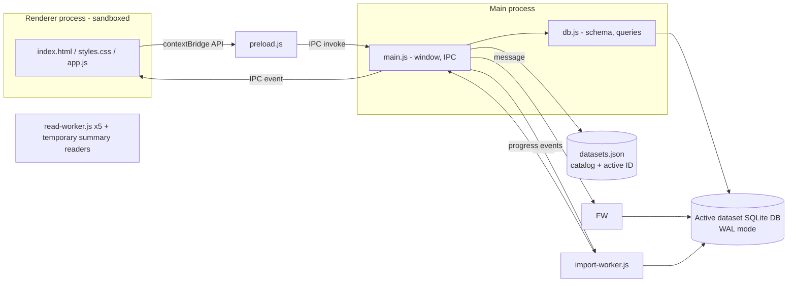

# System description

## Purpose

Browse, filter and read historical job ads offline. Source data is published as one JSONL file per period (e.g. `2026-Q3.jsonl`, ~770 MB, ~130k ads). The app imports such files into a local database and offers a fast, dark-themed UI on top.

## Functional overview

- **Search view**: filter panel (left), keyword box/sort/result list (center), and statistics column (right).
  - Keyword search (headline, employer, description), with `"phrases"` and prefix matching.
  - Hierarchical filters: occupation field → group → occupation; region → municipality.
  - Date range and one-click year chips; employment type; working hours.
  - Organization-ID employer multi-selection from Top employers, with exact-name fallback for missing IDs: native Enter/Space toggle buttons, OR within employers and AND with other filters. Removable "Employer: …" chips use the regular filter flow; ad return/session reload retain selections, while Clear all and dataset switching reset them (D55).
  - Ads-over-time chart stays above publication-date filters in the left column. All six filter/chart widgets collapse independently using their title buttons; collapsed filters show active-selection counts (D27). Sections scroll without shrinking into overlapping titles or inputs.
  - Every filter widget resizes vertically through its bottom divider, with independent remembered body heights and keyboard-accessible separators. Resizing moves subsequent widgets down; overflowing content scrolls within the body. Collapse and Clear all preserve dimensions (D34).
  - Top employers shows the 30 most frequent employer identities under active filters, consolidating spelling/case variants with a shared organization ID (D55). Names and unfiltered totals are precomputed in `employer_catalog`; filtered results count stored IDs and join catalog labels without rebuilding mappings. It uses the statistics widget collapse and vertical-resize behavior; Geography has no placeholder until T5 is implemented. The statistics column's left divider resizes width from an initial/minimum 280 px, with pointer and keyboard controls and an independently saved preference (D36). Filter and statistics columns have independent remembered icon toggles. Statistics auto-hides below 1200 px; when space cannot accommodate both columns and 420 px of results, the most recently opened/resized column wins without overwriting the other's saved preference. Both preferred sidebar widths are temporarily clamped on smaller windows and restored when space returns.
  - Sort: newest, oldest, relevance (keyword only).
  - Results update live while typing/selecting; the list loads incrementally while scrolling.
  - During statistics refresh, Ads over time and Top employers retain dimmed previous content beneath independent loading overlays with spinners and `aria-busy`. Widget titles, dividers and filters remain usable. A shared top progress notice remains until the current count, facets and timeline requests have settled, even after navigation to another view (UI-023, D50).
  - Active filters shown as removable chips; "Clear all".
- **Ad view**: job-ad style presentation (hero header, formatted description, requirements, how to apply, at-a-glance facts, employer info), with a clickable breadcrumb and clickable tags that apply filters.
- **Datasets view**: active dataset name and optional multiline description, editable in place in their displayed typography with adjacent Save/Discard controls (D41), plus import (file picker or drag & drop, multiple files), progress, per-source removal and totals. Editing accepts plain text only and preserves description line breaks. Dirty metadata prompts Save / Discard / Cancel on navigation, dataset switching and app close. Swap opens the T17 dataset chooser; deletion requires confirmation.
- **Settings view**: separate sidebar destination with a compact 450 px Appearance column. Theme is the first row, with its current-name button on the right; it opens the self-themed/fonted chooser with immediate selection, import, independent download/remove actions and protected defaults (D54). Monospace typography remains a separate immediate switch, defaulting on. Both preferences persist independently of datasets. Third-party licenses lists each app package and full license/notice text, plus Electron's bundled Chromium project notices (D56).
- **Manual reprocessing**: Reprocess dataset in Datasets confirms potentially lengthy work, then rebuilds promoted fields, full-text search, summaries, source counts, indexes and planner statistics from stored ads in the build worker (DAT-026, D49). Top progress remains visible across views; imports and dataset mutations are blocked until completion. Failure rolls back and reports both a modal and a dismissible top error notice; completion refreshes results and counts without clearing filters.
- **Navigation**: sidebar menu; Backspace, mouse back/forward buttons and Alt+Left/Right move through view history; `/` searches the current context (list search or in-ad find); `?` opens view-specific shortcut help (D31).
- **Persistence of state**: filters are kept in `sessionStorage` (only while the app is open); tree expansion, layout (including per-widget collapse and heights) and application settings are saved in `localStorage`; the list view is kept alive (hidden) while another view is open, preserving scroll position.

## Architecture

### Components

| File | Role |
|---|---|
| `src/main/main.js` | Creates the window, owns the dataset catalog and active DB path, registers IPC handlers, coordinates worker lifecycle, validates input (file extensions, URL scheme). |
| `src/main/dataset-catalog.js` | Persists stable dataset IDs, names, descriptions, cached statistics and active selection; migrates legacy `ads.db`; resolves only generated IDs to DB paths. |
| `src/main/preload.js` | Exposes a minimal `window.api` via `contextBridge`. |
| `generate-licenses.js` | Builds the distributable license manifest from installed production packages and Electron's runtime license. |
| `src/main/third-party-licenses.js` | Loads the generated manifest and locates Electron's bundled Chromium notice document for the Settings IPC. |
| `src/main/db.js` | Schema, row mapping, filter → SQL builder, search, facets, ad lookup, source removal. Shared by main and workers. |
| `src/main/import-worker.js` | Streams a file, maps records, inserts into `ads` and `ads_fts` in batched transactions, reports progress. |
| `src/main/read-worker.js` | All database reads, on their own connections: five instances (lanes): `lists` (rows, single ad, info), `counts`, `timelines`, `facets` and `build` (one-time summary build, source removal). A newer request supersedes a queued request of the same kind, but active SQL continues; lanes can still contend for disk/cache. Worker responses include execution time for main-process queue/work diagnostics (D37), not exposed in renderer results. |
| `src/main/splash-preload.js`, `src/renderer/splash.*` | Splash window with progress bar shown while the database summary and first results load (UI-014). |
| `src/renderer/app.js` | All UI logic: state, history, list, filter trees, ad rendering, data view. No framework. |
| `src/shared/theme.js`, `src/themes/ams-dark.json`, `src/themes/ams-light.json` | Version-1 semantic color/font contract, shared validation/application and both complete built-in palettes (D51/D52). |
| `src/main/theme-catalog.js` | Loads built-ins/customs and application-wide selection before windows exist; validates bounded UTF-8 files, owns generated-ID copies, serialized import/export/selection/removal and staged-deletion recovery (D53). |
| `src/renderer/theme.js` | Blocking head bootstrap for both windows: applies the saved snapshot before styles load and receives live theme updates without reloading. The Appearance chooser is owned by app.js. |

## Data flow

1. **Import**: renderer asks main to import → main starts `import-worker` → worker streams records → rows + FTS entries inserted (duplicates by ad id skipped), including promoted employer IDs → summaries and affected employer-catalog identities updated in the same transaction → progress events relayed to the UI → on completion the list and facets reload. D55 backfills older stored IDs and builds the catalog once in the build worker before statistics readiness; source removal subtracts variants and refreshes catalog labels/totals transactionally.
2. **Search**: filter change → `setF` saves state → `ads:search` (page of 60), `ads:count`, `ads:timeline` and `ads:facets` run independently. Stale responses are discarded via sequence counters. Non-keyword chronological filters first try a bounded date-index traversal, with an exact original-query fallback (D37).
3. **Dataset lifecycle**: main-process catalog selects one DB path. All read lanes reopen against that path on activation; imports and source removal use the same active path. Dataset changes/deletion are refused during imports or summary builds, and read lanes drain before DB files are staged or switched. The chooser displays cached counts; missing legacy snapshots are backfilled by temporary read workers from `sources`, never by opening databases on the main thread. Successful switches clear session filters and stale async responses, move to Datasets, and reload Search; history entries from the prior dataset are rejected. Renderer edits catalog metadata through validated IPC; app-close and switch requests wait for the renderer's dirty-edit decision.
4. **Open ad**: row click → history `pushState` → `ads:get` returns the stored (null-pruned) JSON from the active dataset → rendered as a job ad.
5. **Background notices** (UI-022, D47): main reports background work on `task:event` (`{key, state: running|done|error, text, pct}`) for summary/index builds, imports, dataset operations, source removal and dataset statistics reads. Main keeps running tasks (plus a summary-build error) for `tasks:list`, which the renderer reads at start. The renderer shows them in `#notices`, a grid row above sidebar and views; it also tracks pending count/timeline/facet refreshes with a renderer-local task and reports their failures there (UI-023, D50). Current-request identity tokens prevent obsolete completions from hiding newer refresh feedback.
6. **Themes** (D51-D54): main validates bundled/custom JSON and reads themes.json before creating windows, using the active background for both. Preloads synchronously read the in-memory snapshot through `theme:current`; head scripts apply all 65 color/two font properties before styles load. `themes:activate` authorizes the main window, validates the registered ID and persists before updating backgrounds/broadcasting `theme:changed`; renderer context and font mode stay intact. The Appearance chooser renders validated snapshots locally per panel and uses native selection buttons with sibling download/trash controls. File actions reuse confirmation/error helpers, obtain paths only from native Open/Save dialogs and use existing task notices; catalog owns generated-ID copies and staged deletion. Invalid active selection falls back with a replayable warning without hiding valid customs. No DB/filesystem access occurs in synchronous IPC. Native OS file-dialog interaction remains manually unverified.
7. **Third-party licenses** (D56): `npm start`, `npm run pack` and `npm run dist` generate `build/third-party-licenses.json` from installed non-development package-lock entries and Electron's own license. electron-builder copies the manifest to app resources. Settings requests it over the preload bridge; main reads Electron's already-bundled `LICENSES.chromium.html` from the app root or macOS framework. The renderer uses text nodes for package license files and a sandboxed, offline frame for Chromium's per-project notices.

## Facet semantics

Each filter group's counts are computed with all *other* filters applied but its own ignored. This lets the user see alternatives within a group (e.g. other occupation fields) while still reflecting keyword, date and location choices.

Options never disappear: every option present in the data is returned with its count (0 when no ad matches) and shown grayed out but selectable (SRC-015). The unfiltered option lists and the chart/total shortcuts come from the summary tables (D23), which the importer keeps current.

Top employers is a statistics widget, not a regular facet option universe: it applies every active filter, including employer selections, and remains limited to 30 identities (SRC-020/SRC-022, D55). Selected employers outside that output remain removable in the active-filter row. Pending refreshes retain employer buttons with unknown counts; refreshed buttons preserve keyboard focus by organization ID or exact missing-ID name, even if the representative label changes after source removal.

D37 groups uncached facets by their effective predicate, materializes compact keys once per shared predicate, and caches at most 32 dimension/predicate count maps per connection. Import/source-removal commits on another connection invalidate these via `PRAGMA data_version`; local writes invalidate via `total_changes()`. Option universes are reread, so removed/new options and zero counts do not depend on cached lists.
